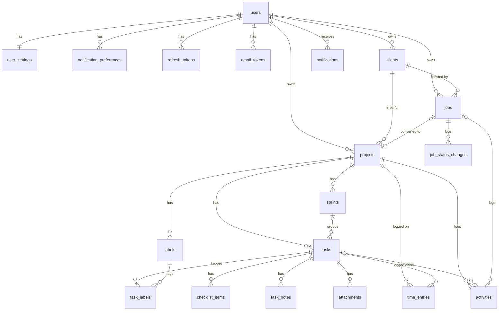

# Taskboard — Tổng quan thiết kế

Taskboard là công cụ giúp freelancer quản lý toàn bộ công việc nhận từ Upwork, đi theo đúng vòng đời của một job:

```
Lưu job thấy trên Upwork → Gửi proposal → Phỏng vấn → Được thuê
   → Dự án (hợp đồng) → Task trên Kanban → Bấm giờ → Báo cáo giờ & thu nhập
```

- **Pipeline job:** theo dõi các job đã lưu, đã apply, đang phỏng vấn; biết mình đã tiêu bao nhiêu connects và tỉ lệ được thuê là bao nhiêu.
- **Dự án & task:** mỗi hợp đồng là một dự án gắn với khách hàng, task quản lý trên bảng Kanban kéo-thả.
- **Bấm giờ:** đồng hồ trên từng task, timesheet theo tuần, cảnh báo khi sắp vượt giới hạn giờ/tuần của hợp đồng.
- **Báo cáo:** giờ làm và thu nhập theo khách hàng / dự án / tuần, xuất PDF và Excel.

Mỗi tài khoản là một freelancer, dữ liệu của mỗi người tách riêng hoàn toàn. Không có tài khoản cho khách hàng.

## 1. Công nghệ

| Hạng mục | Chọn |
|---|---|
| Backend | Java 21, Spring Boot 4.x (Spring Framework 7), Maven (dùng `mvnw`) |
| Kiến trúc | Modular monolith với **Spring Modulith** — mỗi nghiệp vụ là một module, giao tiếp qua API công khai và event (xem mục 3) |
| API | REST JSON, tiền tố `/api/v1`, lỗi theo chuẩn RFC 9457 (`ProblemDetail`), tài liệu bằng springdoc OpenAPI (Swagger UI ở `/swagger-ui`) |
| Bảo mật | Spring Security + OAuth2 Resource Server; ứng dụng tự phát hành JWT (ký RS256 bằng `NimbusJwtEncoder`); mật khẩu BCrypt; giới hạn số lần đăng nhập sai bằng Bucket4j |
| Dữ liệu | PostgreSQL 18, Spring Data JPA (Hibernate 7), Flyway migration; truy vấn báo cáo dùng `JdbcClient` + SQL thuần |
| Realtime | WebSocket + STOMP (simple broker trong bộ nhớ) |
| Việc nền | Event của Spring Modulith (`@ApplicationModuleListener`, lưu bảng `event_publication` để không mất event), `@Scheduled` cho việc định kỳ; bật virtual threads |
| Email | Spring Mail + template Thymeleaf |
| Lưu file | AWS S3 (SDK v2), upload/download bằng presigned URL; mọi môi trường đều dùng S3 (bucket riêng cho dev và UAT) |
| Xuất file | Excel bằng Apache POI; PDF bằng Thymeleaf + openhtmltopdf (HTML → PDF) |
| Mapping / kiểm tra dữ liệu | DTO là Java `record`, MapStruct để map entity ↔ DTO, Jakarta Bean Validation |
| Giám sát | Spring Boot Actuator (health cho Docker), Micrometer; log dạng JSON ở UAT, có request id |
| Frontend | Node 22 LTS, React 19 + Vite + TypeScript, TanStack Router + TanStack Query |
| Giao diện | **MUI (Material UI)**: component, theme sáng/tối, style bằng `sx` / `styled` (Emotion), không dùng Tailwind; icon `@mui/icons-material`; font Inter (`@fontsource/inter`) |
| MUI X (bản miễn phí) | **Data Grid** cho mọi bảng (sắp xếp, lọc, phân trang phía server); **Date Pickers** (adapter date-fns) cho hạn chót, ngày follow-up, chọn tuần timesheet, khoảng ngày báo cáo; **Charts** cho biểu đồ báo cáo và dashboard |
| Thư viện frontend khác | `dnd-kit` (kéo-thả Kanban), `@stomp/stompjs` (realtime), `openapi-typescript` + `openapi-fetch` (kiểu TS sinh từ OpenAPI), react-hook-form + zod, date-fns, `react-markdown`, `react-i18next` |
| Ngôn ngữ UI | Tiếng Việt khi phát triển; mọi text đi qua i18n; thêm tiếng Anh ở tuần 7 |
| Test | JUnit + AssertJ + Mockito; **Testcontainers** (PostgreSQL thật) cho test tích hợp; kiểm tra ranh giới module bằng Spring Modulith; JaCoCo đo coverage; Playwright E2E cho frontend |
| Chất lượng code | Spotless (palantir-java-format), ESLint + Prettier |
| CI / Deploy | GitHub Actions → image (arm64) lên GitHub Container Registry → 1 EC2 (t4g.small) chạy Docker Compose; email Amazon SES; HTTPS bằng Let's Encrypt; backup DB hằng ngày lên S3 |

### Quy ước

- **Thư mục:** xem mục 3.
- **API:** tiền tố `/api/v1`, JSON, tên field `camelCase`. Phân trang `?page=0&size=20` → `{ "items": [...], "page": 0, "size": 20, "total": 134 }`.
- **Lỗi:** mọi lỗi trả về một khuôn `ProblemDetail` có thêm `code` và `errors`:

  ```json
  {
    "type": "about:blank",
    "title": "Time entry overlaps another entry",
    "status": 409,
    "code": "TIME_ENTRY_OVERLAP",
    "instance": "/api/v1/time-entries",
    "errors": { "startedAt": ["Khoảng thời gian bị trùng với bản ghi khác"] }
  }
  ```

  Một số `code`: `VALIDATION_FAILED`, `UNAUTHENTICATED`, `NOT_FOUND`, `RATE_LIMITED`, `EMAIL_NOT_VERIFIED`, `PROJECT_KEY_TAKEN`, `PROJECT_NOT_ACTIVE`, `JOB_ALREADY_CONVERTED`, `CLIENT_HAS_ACTIVE_PROJECTS`, `TASK_VERSION_CONFLICT`, `TASK_HAS_TIME_ENTRIES`, `TIME_ENTRY_OVERLAP`.
- **Token:** access token 15 phút, giữ trong bộ nhớ của frontend (không lưu localStorage). Refresh token 7 ngày, nằm trong cookie `HttpOnly; Secure; SameSite=Strict; Path=/api/v1/auth`, mỗi lần refresh đổi token mới (rotation).
- **Tiền:** lưu số nguyên theo cent (USD), không dùng float. Phần trăm lưu `numeric(5,2)`.
- **Thời gian:** lưu UTC (`timestamptz` ↔ `Instant`), hiển thị theo múi giờ của user. Ngày không có giờ (hạn chót, ngày follow-up) lưu `date` ↔ `LocalDate`, hiểu theo múi giờ của user.
- **Tuần làm việc:** giống Upwork — Thứ 2 00:00 UTC đến Chủ nhật 23:59 UTC (BR-08).
- **Mã task:** `<KEY dự án>-<số>`, ví dụ `ACME-12`. Dùng mã này trên URL và trong giao diện.
- **Form:** trường bắt buộc có `*` đỏ; trường không bắt buộc không ghi chú thêm; placeholder chung chung ("Nhập email"); ô mật khẩu dùng placeholder `******`.
- **Giao diện:** có chế độ sáng / tối (theo hệ điều hành, đổi được trên header, nhớ lựa chọn); drawer chi tiết task và job mở bằng search param (`?task=ACME-12`) để copy link mở lại đúng chỗ.
- **Style:** màu, font, bo góc, khoảng cách chỉ khai báo trong `theme/`; component dùng giá trị của theme (`theme.palette`, `theme.spacing`), không viết cứng mã màu. Style nhỏ dùng `sx`, style dùng lại nhiều lần thì tách thành component bằng `styled` hoặc ghi đè trong `theme.components`.
- **Ngôn ngữ của component:** đổi ngôn ngữ thì đổi luôn locale của MUI, Data Grid và Date Pickers (`viVN` / `enUS`) để chữ có sẵn trong component (phân trang, bộ lọc, lịch) cũng đúng ngôn ngữ.

Một số thiết lập được giữ đơn giản:

- Cột Kanban của task cố định 5 cột (BR-05), không cho tự đặt cột.
- Phí Upwork mặc định 10%, giá 1 connect mặc định $0.15 — user sửa được trong cài đặt; dự án lấy phí mặc định khi tạo và sửa riêng được.
- Secret (khoá JWT, key AWS, mật khẩu DB) để trong `.env` (không commit), trên CI dùng GitHub Secrets.
- Chạy 1 instance nên WebSocket dùng simple broker trong bộ nhớ, rate limit và scheduler không cần khoá phân tán.
- UAT chạy thường trực trên 1 EC2 để giữ chi phí khoảng $15/tháng.

## 2. Môi trường chạy

Cùng một mã nguồn chạy được ở 3 môi trường, chỉ khác Spring profile và file `.env`:

| | Dev trên máy (hằng ngày) | Docker (trên máy) | UAT (AWS) |
|---|---|---|---|
| Khi nào dùng | Code hằng ngày; chỉ PostgreSQL và Mailpit chạy bằng Docker | Kiểm tra lần cuối trước khi đưa lên UAT, giống UAT nhất | Bản demo và bản dùng thật hằng ngày |
| Spring profile | `dev` | `docker` | `uat` |
| Backend | `./mvnw spring-boot:run` (có devtools tự restart) → `http://localhost:8080` | container `app` | container `app` trên EC2 |
| Frontend | `npm run dev` (Vite) → `http://localhost:5173`, proxy `/api` và `/ws` sang cổng 8080 | nginx phục vụ bản build | nginx phục vụ bản build |
| Database | PostgreSQL 18 container từ `docker-compose.dev.yml` → `localhost:5432` (dữ liệu giữ trong volume) | PostgreSQL 18 container | PostgreSQL 18 container, `pg_dump` hằng đêm lên S3 |
| Migration | Flyway tự chạy khi app khởi động | như bên trái | như bên trái |
| Scheduler, event | chạy trong app | chạy trong app | chạy trong app |
| Mail | Mailpit container từ `docker-compose.dev.yml` → `http://localhost:8025` | Mailpit container | Amazon SES (SMTP) |
| File | S3 bucket `taskboard-dev` | S3 bucket `taskboard-dev` | S3 bucket `taskboard-uat` |
| Test tích hợp | Testcontainers tự bật một PostgreSQL riêng cho test, không đụng vào DB dev | — | — |

- Dev hằng ngày: `docker compose -f docker-compose.dev.yml up -d` (chỉ có `postgres` và `mailpit`), rồi chạy backend bằng `./mvnw spring-boot:run` và frontend bằng `npm run dev` như bình thường. Máy cần Docker Desktop.
- Backend đọc `.env` bằng `spring.config.import=optional:file:.env[.properties]`; có file mẫu `.env.example` (dev), `.env.docker.example`, `.env.uat.example`. File `.env` thật không commit.
- Khoá ký JWT (cặp RSA) để dạng PEM trong `.env`; dev có lệnh tạo sẵn ghi trong README.
- Trước khi đưa lên UAT: chạy `docker compose up --build`, chạy Playwright với bản Docker; có lỗi thì không deploy.

## 3. Cấu trúc thư mục

```
repositories/taskboard/
├── backend/                     # Spring Boot API
├── frontend/                    # React + Vite SPA
├── docker/
│   ├── backend/Dockerfile       # multi-stage: build bằng mvnw → chạy trên eclipse-temurin 21 JRE, layered jar
│   ├── frontend/Dockerfile      # build Vite, copy dist/ vào nginx
│   ├── nginx/default.conf       # /api, /ws → app:8080 (có upgrade WebSocket); còn lại → frontend build
│   └── backup/backup.sh         # pg_dump → nén → đẩy lên S3, giữ 14 bản gần nhất
├── docker-compose.dev.yml       # dev hằng ngày: chỉ postgres + mailpit (backend, frontend chạy thẳng trên máy)
├── docker-compose.yml           # nginx, app, postgres, mailpit
├── docker-compose.uat.yml       # ghi đè cho UAT (không có mailpit; dùng image từ GHCR; thêm container backup)
├── .github/workflows/
│   ├── ci.yml                   # backend: Spotless + test (Testcontainers) + JaCoCo; frontend: lint + typecheck + build; Playwright
│   └── deploy-uat.yml           # build image arm64 → GHCR → SSH vào EC2 → compose pull + up
├── docs/
│   ├── overview.md              # file này
│   └── plans/                   # chuan-bi.md, week-1..8.md, tracker.md
└── README.md
```

### Backend (`backend/`)

Mỗi module là một package ngay dưới `com.taskboard`. **Package gốc của module là API công khai** (service cho module khác gọi, event, DTO); mọi thứ trong `internal/` chỉ module đó được dùng. Spring Modulith kiểm tra quy tắc này bằng test (`ModularityTests`).

```
backend/
├── pom.xml
├── mvnw, .mvn/
├── src/main/java/com/taskboard/
│   ├── TaskboardApplication.java
│   │
│   ├── shared/                          # module dùng chung (khai báo OPEN), không chứa nghiệp vụ
│   │   ├── web/                         #   PageResponse, ApiException, ErrorCode, GlobalExceptionHandler (→ ProblemDetail)
│   │   │                                #   map tên constraint DB → code lỗi (vd. ex_time_entries_no_overlap → TIME_ENTRY_OVERLAP)
│   │   ├── security/                    #   CurrentUser (id, timezone) + resolver lấy từ JWT
│   │   ├── persistence/                 #   BaseEntity (id, createdAt, updatedAt), cấu hình JPA auditing
│   │   ├── ordering/                    #   FractionalIndex — sinh khoá thứ tự giữa 2 khoá (dùng cho Kanban)
│   │   ├── time/                        #   UpworkWeek (tính tuần theo UTC), cấu hình Clock (để test cố định giờ)
│   │   ├── money/                       #   Money (cent ↔ $, tính phí %)
│   │   └── storage/                     #   FileStorage (presigned PUT/GET, xoá file) → S3
│   │
│   ├── identity/                        # tài khoản, đăng nhập, cài đặt cá nhân
│   │   ├── UserDirectory.java           #   API công khai: lấy timezone, cài đặt mặc định (rate, phí, giá connect)
│   │   ├── UserRegistered.java          #   event
│   │   └── internal/
│   │       ├── web/                     #   AuthController, MeController, request/response record
│   │       ├── domain/                  #   User, UserSettings, RefreshToken, EmailToken, NotificationPreference + repository
│   │       ├── service/                 #   RegisterUser, VerifyEmail, Login, RefreshSession, ResetPassword, UpdateProfile…
│   │       └── security/                #   SecurityConfig, JwtIssuer, LoginRateLimiter, RefreshCookie
│   │
│   ├── client/                          # khách hàng
│   │   ├── ClientCatalog.java           #   API công khai: kiểm tra client thuộc user, lấy tên
│   │   └── internal/ web/ domain/ service/
│   │
│   ├── pipeline/                        # job Upwork: lưu, apply, phỏng vấn, được thuê / trượt
│   │   ├── JobStatusChanged.java, JobConverted.java
│   │   └── internal/ web/ domain/ service/   # MoveJob, ConvertJobToProject (gọi ProjectRegistry), JobStats
│   │
│   ├── project/                         # dự án, sprint, nhãn
│   │   ├── ProjectRegistry.java         #   API công khai: tạo dự án từ job, lấy rate/phí/giới hạn tuần, cấp số task tiếp theo
│   │   ├── ProjectStatusChanged.java
│   │   └── internal/ web/ domain/ service/
│   │
│   ├── task/                            # task, checklist, ghi chú, file đính kèm, tìm kiếm
│   │   ├── TaskLookup.java              #   API công khai: tìm task theo mã, chuyển sang IN_PROGRESS khi bắt đầu bấm giờ
│   │   ├── TaskCreated.java, TaskUpdated.java, TaskMoved.java, TaskDeleted.java
│   │   └── internal/ web/ domain/ service/   # MoveTask (fractional index + optimistic lock), AttachmentService…
│   │
│   ├── timetracking/                    # đồng hồ, bản ghi giờ, timesheet, giới hạn tuần
│   │   ├── TimerStarted.java, TimerStopped.java, WeeklyLimitReached.java
│   │   └── internal/ web/ domain/ service/   # StartTimer, StopTimer, LogTimeManually, WeeklyLimitChecker
│   │
│   ├── reporting/                       # dashboard Hôm nay, báo cáo, xuất PDF/Excel, tìm kiếm nhanh (Ctrl+K)
│   │   └── internal/
│   │       ├── web/
│   │       ├── query/                   #   SQL thuần bằng JdbcClient, chỉ đọc (được phép đọc bảng của module khác)
│   │       └── export/                  #   ExcelExporter (POI), PdfExporter (openhtmltopdf)
│   │
│   ├── notification/                    # thông báo trong app + email + nhắc việc định kỳ
│   │   └── internal/
│   │       ├── web/
│   │       ├── domain/
│   │       ├── listener/                #   nghe WeeklyLimitReached, JobStatusChanged…
│   │       ├── reminder/                #   @Scheduled: task sắp tới hạn, follow-up job, đồng hồ chạy quá lâu, tổng kết tuần
│   │       └── mail/                    #   MailSender + template
│   │
│   ├── activity/                        # lịch sử thay đổi của task và job
│   │   └── internal/                    #   nghe event của task/pipeline → ghi bảng activities; API đọc lịch sử
│   │
│   └── realtime/                        # WebSocket
│       └── internal/                    #   WebSocketConfig (STOMP /ws), xác thực JWT lúc CONNECT,
│                                        #   nghe event của task/pipeline/timetracking/notification → đẩy về /user/queue/events
├── src/main/resources/
│   ├── application.yml                  # cấu hình chung
│   ├── application-dev.yml, application-docker.yml, application-uat.yml
│   ├── db/migration/                    # V1__identity_init.sql, V2__client_init.sql… (mục 4)
│   ├── templates/mail/                  # verify-email, reset-password, task-due, job-follow-up, weekly-summary
│   ├── templates/report/                # mẫu HTML cho báo cáo PDF
│   └── i18n/messages_vi.properties, messages_en.properties   # text email, tiêu đề thông báo, lỗi validate
└── src/test/java/com/taskboard/
    ├── ModularityTests.java             # ApplicationModules.verify() + sinh tài liệu module (PlantUML)
    ├── support/                         # TestcontainersConfiguration (@ServiceConnection PostgreSQL), dữ liệu mẫu, Clock cố định
    ├── shared/                          # unit test: FractionalIndex, UpworkWeek, Money
    └── <module>/                        # mỗi module: test API (MockMvcTester/RestTestClient) + @ApplicationModuleTest cho event
```

Quy tắc:

- Controller mỏng: nhận request record (đã `@Valid`) → gọi service → trả response record. Controller không gọi repository.
- Service là một nghiệp vụ, đánh dấu `@Transactional`. Module khác chỉ được gọi class ở package gốc của module, không gọi vào `internal/`.
- Việc phụ (ghi lịch sử, gửi thông báo, đẩy realtime) làm bằng event, không gọi thẳng. Listener dùng `@ApplicationModuleListener` (chạy sau khi commit, chạy nền, được lưu lại để chạy lại nếu lỗi).
- Mọi truy vấn dữ liệu của user đều có `ownerId` (`findByIdAndOwnerId`…). Không tìm thấy hoặc không phải của mình đều trả 404 (BR-01).
- Entity không trả thẳng ra API; luôn map sang record.

Chiều phụ thuộc giữa các module (không được có vòng):

```
identity ← client ← project ← task ← timetracking
                ↖ pipeline ↗ (gọi ProjectRegistry khi chuyển job thành dự án)
activity, notification, realtime: chỉ nghe event
reporting: chỉ đọc bằng SQL
```

### Frontend (`frontend/`)

```
frontend/
├── src/
│   ├── routes/                          # TanStack Router, file-based — đường dẫn URL = cấu trúc thư mục
│   │   ├── __root.tsx
│   │   ├── _auth/                       # layout 2 cột, không sidebar — màn 1
│   │   │   ├── login.tsx, register.tsx, verify-email.tsx, forgot-password.tsx, reset-password.tsx
│   │   └── _app/                        # layout chính: sidebar + header (ô tìm Ctrl+K, đồng hồ đang chạy, chuông, avatar)
│   │       ├── index.tsx                #   màn 2  /               Hôm nay
│   │       ├── pipeline/index.tsx       #   màn 3, 4  /pipeline    (?job=123 mở drawer)
│   │       ├── clients/                 #   màn 5, 6  /clients, /clients/$clientId
│   │       ├── projects/
│   │       │   ├── index.tsx            #   màn 7  /projects
│   │       │   └── $projectKey/
│   │       │       ├── index.tsx        #   màn 8  /projects/ACME  (?task=ACME-12 mở drawer — màn 9)
│   │       │       └── settings.tsx     #   màn 13 /projects/ACME/settings
│   │       ├── tasks/index.tsx          #   màn 10 /tasks          Task của tôi
│   │       ├── timesheet/index.tsx      #   màn 11 /timesheet?week=2027-W03
│   │       ├── reports/index.tsx        #   màn 12 /reports
│   │       ├── notifications/index.tsx  #   màn 15
│   │       └── settings/index.tsx       #   màn 14 /settings
│   ├── features/                        # theo nghiệp vụ; mỗi thư mục gồm api.ts (gọi API + query key),
│   │   ├── auth/                        #   hooks (useXxxQuery / useXxxMutation), component riêng của nghiệp vụ
│   │   ├── pipeline/                    #   JobBoard, JobDrawer, ConvertJobDialog, PipelineStats
│   │   ├── clients/
│   │   ├── projects/                    #   ProjectForm, SprintList, LabelManager
│   │   ├── tasks/                       #   TaskBoard (dnd-kit), TaskCard, TaskDrawer, Checklist, Notes, Attachments, ActivityList
│   │   ├── time/                        #   TimerWidget (header), TimesheetGrid, TimeEntryDialog, WeeklyLimitBar
│   │   ├── reports/                     #   biểu đồ (MUI X Charts), bảng tổng hợp, nút xuất file
│   │   ├── dashboard/
│   │   ├── notifications/               #   popover chuông dùng chung (MUI Popover + Badge)
│   │   ├── search/                      #   tìm nhanh Ctrl+K (MUI Dialog + Autocomplete)
│   │   └── realtime/                    #   nhận event STOMP → cập nhật cache TanStack Query
│   ├── theme/
│   │   ├── index.ts                     # createTheme: bảng màu light + dark (colorSchemes), font, bo góc, spacing
│   │   ├── components.ts                # ghi đè mặc định của component MUI (Button, Card, Drawer, DataGrid…)
│   │   └── ThemeProvider.tsx            # ThemeProvider + CssBaseline + LocalizationProvider (date-fns) + đổi sáng/tối
│   ├── components/
│   │   ├── layout/                      # AppSidebar, AppHeader, AuthLayout
│   │   └── common/                      # AppDataGrid (Data Grid đã nối phân trang/sắp xếp server + locale), EmptyState,
│   │                                    # ErrorState, ConfirmDialog, PageHeader, FormTextField (nối react-hook-form), Markdown
│   ├── lib/
│   │   ├── api/schema.d.ts              # sinh tự động từ OpenAPI (`npm run gen:api`), không sửa tay
│   │   ├── api/client.ts                # openapi-fetch + middleware: gắn access token, gặp 401 thì gọi refresh rồi thử lại, map ProblemDetail
│   │   ├── auth.ts                      # giữ access token trong bộ nhớ, user hiện tại, guard route
│   │   ├── realtime.ts                  # STOMP client: kết nối /ws, tự nối lại, gửi token mới khi token đổi
│   │   ├── money.ts                     # cent → "$12.00"
│   │   ├── date.ts                      # đổi múi giờ, tuần Upwork, format thời lượng "2h 15m"
│   │   └── i18n.ts
│   ├── locales/vi/*.json, locales/en/*.json
│   └── main.tsx
├── e2e/                                 # Playwright: auth.spec.ts, pipeline.spec.ts, board.spec.ts, timer.spec.ts, report.spec.ts
├── public/
└── vite.config.ts                       # proxy /api và /ws → http://localhost:8080 khi dev
```

Quy tắc: route chỉ ghép layout và gọi component trong `features/`; component không gọi `fetch` trực tiếp mà qua `api.ts`; kiểu dữ liệu API lấy từ `schema.d.ts`, không tự khai báo lại; mọi text hiển thị lấy từ `locales/`; bảng dữ liệu luôn dùng `AppDataGrid`, không tự dựng bảng bằng `Table`; import MUI theo đường dẫn từng component (`@mui/material/Button`) để bản build nhỏ.

## 4. Thiết kế database

### Quy ước chung

- PostgreSQL 18, tên bảng số nhiều, `snake_case`. Cần extension `btree_gist` (cho ràng buộc chống trùng giờ).
- Khoá chính `id bigint GENERATED ALWAYS AS IDENTITY`.
- Enum lưu `varchar` + `CHECK` (không dùng kiểu enum của Postgres để thêm giá trị bằng migration cho dễ); Java dùng `@Enumerated(EnumType.STRING)`.
- Mọi bảng có `created_at`; bảng được sửa có thêm `updated_at`. Bảng có thể bị sửa cùng lúc từ 2 tab có `version bigint` (optimistic lock, `@Version`).
- Bảng thuộc về user có `owner_id` (kể cả khi suy ra được qua bảng cha) để mọi truy vấn lọc thẳng theo user và có index.
- Dữ liệu nghiệp vụ không xoá mà đặt `archived_at`; bảng con của task (checklist, ghi chú, file) xoá theo `ON DELETE CASCADE`.
- Cột thứ tự Kanban (`position`) là chuỗi so sánh theo byte nên khai báo `COLLATE "C"`.
- Migration Flyway đặt tên `V{số}__{module}_{mô_tả}.sql`, không sửa file đã chạy.

### Sơ đồ quan hệ



### Module `identity`

**`users`**

| Cột | Kiểu | Ràng buộc / ghi chú |
|---|---|---|
| id | bigint | PK |
| email | varchar(255) | NOT NULL; unique index trên `lower(email)` |
| password_hash | varchar(255) | NOT NULL, BCrypt |
| full_name | varchar(100) | NOT NULL |
| avatar_key | varchar(300) | key trên S3, null = chưa có ảnh |
| timezone | varchar(64) | NOT NULL, mặc định `Asia/Ho_Chi_Minh` (tên IANA) |
| locale | varchar(5) | NOT NULL, `vi` / `en` |
| email_verified_at | timestamptz | null = chưa xác minh, chưa đăng nhập được |
| created_at, updated_at | timestamptz | |

**`user_settings`** — quan hệ 1-1 với `users`, tạo cùng lúc khi đăng ký.

| Cột | Kiểu | Ràng buộc / ghi chú |
|---|---|---|
| user_id | bigint | PK, FK → users ON DELETE CASCADE |
| default_hourly_rate_cents | bigint | rate gợi ý khi tạo job/dự án, null = không gợi ý |
| upwork_fee_percent | numeric(5,2) | NOT NULL, mặc định 10.00, CHECK 0–100 |
| connect_price_cents | integer | NOT NULL, mặc định 15 |
| weekly_goal_minutes | integer | mục tiêu tổng giờ/tuần hiện trên dashboard, null = không đặt |
| reminder_hour | smallint | NOT NULL, mặc định 8; giờ địa phương gửi nhắc việc, CHECK 0–23 |
| updated_at | timestamptz | |

**`notification_preferences`** — chỉ lưu dòng user đã đổi khác mặc định; không có dòng = dùng mặc định trong code.

| Cột | Kiểu | Ràng buộc / ghi chú |
|---|---|---|
| user_id | bigint | FK → users ON DELETE CASCADE |
| type | varchar(40) | `TASK_DUE_SOON`, `JOB_FOLLOW_UP`, `TIMER_LONG_RUNNING`, `WEEKLY_LIMIT`, `WEEKLY_SUMMARY` |
| in_app | boolean | NOT NULL |
| email | boolean | NOT NULL |
| | | PK (user_id, type) |

**`refresh_tokens`**

| Cột | Kiểu | Ràng buộc / ghi chú |
|---|---|---|
| id | bigint | PK |
| user_id | bigint | FK → users ON DELETE CASCADE; index |
| token_hash | char(64) | NOT NULL, unique; SHA-256 của token (không lưu token gốc) |
| family_id | uuid | NOT NULL; index. Các token sinh nối tiếp nhau từ một lần đăng nhập chung một family |
| expires_at | timestamptz | NOT NULL |
| revoked_at | timestamptz | đã dùng để đổi token mới, đã đăng xuất, hoặc bị thu hồi |
| user_agent | varchar(255) | |
| ip_address | inet | |
| created_at | timestamptz | |

**`email_tokens`** — link xác minh email và đặt lại mật khẩu.

| Cột | Kiểu | Ràng buộc / ghi chú |
|---|---|---|
| id | bigint | PK |
| user_id | bigint | FK → users ON DELETE CASCADE |
| purpose | varchar(20) | `VERIFY_EMAIL` / `RESET_PASSWORD` |
| token_hash | char(64) | NOT NULL, unique |
| expires_at | timestamptz | NOT NULL (xác minh: 24 giờ, đặt lại mật khẩu: 30 phút) |
| used_at | timestamptz | dùng rồi thì không dùng lại được |
| created_at | timestamptz | |

### Module `client`

**`clients`**

| Cột | Kiểu | Ràng buộc / ghi chú |
|---|---|---|
| id | bigint | PK |
| owner_id | bigint | FK → users, NOT NULL |
| name | varchar(120) | NOT NULL; unique (owner_id, lower(name)) |
| company | varchar(120) | |
| country_code | char(2) | ISO 3166-1 |
| timezone | varchar(64) | để biết giờ bên khách khi hẹn họp |
| email | varchar(255) | |
| upwork_url | varchar(500) | link hồ sơ khách trên Upwork |
| notes | text | markdown |
| archived_at | timestamptz | |
| created_at, updated_at | timestamptz | |

Index: (owner_id) WHERE archived_at IS NULL.

### Module `pipeline`

**`jobs`**

| Cột | Kiểu | Ràng buộc / ghi chú |
|---|---|---|
| id | bigint | PK |
| owner_id | bigint | FK → users, NOT NULL |
| client_id | bigint | FK → clients; null khi chưa biết khách là ai |
| project_id | bigint | FK → projects, unique; có giá trị khi đã chuyển thành dự án |
| title | varchar(200) | NOT NULL |
| url | varchar(500) | link job trên Upwork |
| source | varchar(20) | `UPWORK` / `DIRECT` / `REFERRAL` / `OTHER`, mặc định `UPWORK` |
| description | text | dán mô tả job |
| skills | text[] | NOT NULL, mặc định `'{}'`; index GIN để lọc theo kỹ năng |
| budget_type | varchar(10) | `HOURLY` / `FIXED` |
| budget_min_cents, budget_max_cents | bigint | khoảng ngân sách khách đưa ra |
| bid_cents | bigint | rate mình chào (hourly) hoặc giá mình chào (fixed) |
| connects_spent | integer | NOT NULL, mặc định 0, CHECK ≥ 0 (gồm cả connects boost) |
| cover_letter | text | nội dung proposal đã gửi |
| status | varchar(20) | `SAVED` / `APPLIED` / `INTERVIEWING` / `HIRED` / `LOST` |
| lost_reason | varchar(30) | `NO_RESPONSE` / `CLIENT_HIRED_OTHER` / `BUDGET_MISMATCH` / `I_DECLINED` / `JOB_CLOSED` / `OTHER`; bắt buộc khi `LOST` (CHECK) |
| position | varchar(64) COLLATE "C" | NOT NULL, thứ tự trong cột Kanban |
| applied_at | timestamptz | đặt lần đầu chuyển sang `APPLIED` |
| follow_up_on | date | ngày nhắc follow-up |
| closed_at | timestamptz | lúc chuyển sang `HIRED` / `LOST` |
| archived_at | timestamptz | ẩn khỏi bảng |
| version | bigint | optimistic lock |
| created_at, updated_at | timestamptz | |

Index: (owner_id, status, position) WHERE archived_at IS NULL; GIN (skills); (follow_up_on) WHERE status IN ('APPLIED', 'INTERVIEWING').

**`job_status_changes`** — dùng để tính thống kê pipeline (bao lâu từ apply tới được thuê, bao nhiêu job tới được vòng phỏng vấn).

| Cột | Kiểu | Ràng buộc / ghi chú |
|---|---|---|
| id | bigint | PK |
| job_id | bigint | FK → jobs ON DELETE CASCADE; index |
| from_status | varchar(20) | null khi vừa tạo job |
| to_status | varchar(20) | NOT NULL |
| changed_at | timestamptz | NOT NULL |

### Module `project`

**`projects`**

| Cột | Kiểu | Ràng buộc / ghi chú |
|---|---|---|
| id | bigint | PK |
| owner_id | bigint | FK → users, NOT NULL |
| client_id | bigint | FK → clients, NOT NULL |
| name | varchar(120) | NOT NULL |
| key | varchar(6) | NOT NULL, CHECK `key ~ '^[A-Z][A-Z0-9]{1,5}$'`; unique (owner_id, key); không đổi sau khi tạo |
| description | text | |
| color | varchar(7) | mã màu hex hiện trên thẻ task, sidebar |
| contract_type | varchar(10) | `HOURLY` / `FIXED` |
| hourly_rate_cents | bigint | bắt buộc khi `HOURLY` |
| fixed_price_cents | bigint | bắt buộc khi `FIXED` |
| weekly_limit_minutes | integer | giới hạn giờ/tuần của hợp đồng; null = không giới hạn |
| upwork_fee_percent | numeric(5,2) | NOT NULL, lấy mặc định từ `user_settings` khi tạo |
| status | varchar(20) | `ACTIVE` / `PAUSED` / `COMPLETED` / `ARCHIVED` |
| started_on, ended_on | date | |
| next_task_number | integer | NOT NULL, mặc định 1; cấp số task bằng `UPDATE … SET next_task_number = next_task_number + 1 … RETURNING` |
| version | bigint | |
| created_at, updated_at | timestamptz | |

CHECK: `(contract_type = 'HOURLY' AND hourly_rate_cents IS NOT NULL) OR (contract_type = 'FIXED' AND fixed_price_cents IS NOT NULL)`. Index: (owner_id, status), (client_id).

**`sprints`** — dùng cho dự án fixed (dự án hourly cũng tạo được để chia giai đoạn).

| Cột | Kiểu | Ràng buộc / ghi chú |
|---|---|---|
| id | bigint | PK |
| project_id | bigint | FK → projects ON DELETE CASCADE |
| title | varchar(150) | NOT NULL |
| amount_cents | bigint | |
| due_on | date | |
| status | varchar(20) | `PENDING` / `ACTIVE` / `SUBMITTED` / `PAID` |
| paid_at | timestamptz | đặt khi chuyển sang `PAID`; dùng để tính thu nhập dự án fixed |
| position | integer | thứ tự hiển thị |
| created_at, updated_at | timestamptz | |

**`labels`**

| Cột | Kiểu | Ràng buộc / ghi chú |
|---|---|---|
| id | bigint | PK |
| project_id | bigint | FK → projects ON DELETE CASCADE |
| name | varchar(30) | NOT NULL; unique (project_id, lower(name)) |
| color | varchar(7) | NOT NULL |

### Module `task`

**`tasks`**

| Cột | Kiểu | Ràng buộc / ghi chú |
|---|---|---|
| id | bigint | PK |
| owner_id | bigint | FK → users, NOT NULL |
| project_id | bigint | FK → projects, NOT NULL |
| number | integer | NOT NULL; unique (project_id, number) → mã `ACME-12` |
| title | varchar(200) | NOT NULL |
| description | text | markdown |
| status | varchar(20) | `BACKLOG` / `TODO` / `IN_PROGRESS` / `REVIEW` / `DONE` |
| priority | varchar(10) | `LOW` / `MEDIUM` / `HIGH` / `URGENT`, mặc định `MEDIUM` |
| position | varchar(64) COLLATE "C" | NOT NULL, thứ tự trong cột |
| sprint_id | bigint | FK → sprints ON DELETE SET NULL |
| due_on | date | |
| estimate_minutes | integer | CHECK > 0 |
| completed_at | timestamptz | đặt khi vào `DONE`, xoá khi rời `DONE` |
| archived_at | timestamptz | |
| search | tsvector | `GENERATED ALWAYS AS (to_tsvector('simple', title || ' ' || coalesce(description, ''))) STORED`; index GIN |
| version | bigint | optimistic lock |
| created_at, updated_at | timestamptz | |

Index: (project_id, status, position) WHERE archived_at IS NULL; (owner_id, due_on) WHERE status <> 'DONE' AND archived_at IS NULL; GIN (search).

**`task_labels`**: `task_id` (FK → tasks ON DELETE CASCADE), `label_id` (FK → labels ON DELETE CASCADE), PK (task_id, label_id).

**`checklist_items`**

| Cột | Kiểu | Ràng buộc / ghi chú |
|---|---|---|
| id | bigint | PK |
| task_id | bigint | FK → tasks ON DELETE CASCADE; index |
| content | varchar(300) | NOT NULL |
| done | boolean | NOT NULL, mặc định false |
| position | integer | NOT NULL |

**`task_notes`** — ghi chú tiến độ theo dòng thời gian trong task (nhật ký làm việc, nội dung trao đổi với khách).

| Cột | Kiểu | Ràng buộc / ghi chú |
|---|---|---|
| id | bigint | PK |
| task_id | bigint | FK → tasks ON DELETE CASCADE; index |
| body | text | NOT NULL, markdown |
| created_at, updated_at | timestamptz | |

**`attachments`**

| Cột | Kiểu | Ràng buộc / ghi chú |
|---|---|---|
| id | bigint | PK |
| owner_id | bigint | FK → users, NOT NULL |
| task_id | bigint | FK → tasks ON DELETE CASCADE; index |
| file_name | varchar(255) | NOT NULL, tên gốc |
| content_type | varchar(100) | NOT NULL |
| size_bytes | bigint | NOT NULL, CHECK ≤ 10 485 760 (10 MB) |
| storage_key | varchar(300) | NOT NULL, unique; `users/{ownerId}/tasks/{taskId}/{uuid}` |
| status | varchar(10) | `PENDING` (đã cấp URL upload) / `UPLOADED` (đã xác nhận) |
| created_at | timestamptz | |

### Module `timetracking`

**`time_entries`**

| Cột | Kiểu | Ràng buộc / ghi chú |
|---|---|---|
| id | bigint | PK |
| owner_id | bigint | FK → users, NOT NULL |
| project_id | bigint | FK → projects, NOT NULL |
| task_id | bigint | FK → tasks ON DELETE RESTRICT; null = ghi giờ chung cho dự án |
| started_at | timestamptz | NOT NULL |
| ended_at | timestamptz | null = đồng hồ đang chạy |
| duration_seconds | integer | `GENERATED ALWAYS AS (EXTRACT(EPOCH FROM ended_at - started_at)::integer) STORED` |
| source | varchar(10) | `TIMER` / `MANUAL` |
| billable | boolean | NOT NULL, mặc định true |
| rate_cents | bigint | rate của dự án lúc ghi (null với dự án fixed) |
| note | varchar(500) | |
| version | bigint | |
| created_at, updated_at | timestamptz | |

Ba ràng buộc quan trọng nằm ngay trong DB:

```sql
-- giờ kết thúc phải sau giờ bắt đầu
ALTER TABLE time_entries ADD CONSTRAINT ck_time_entries_range
    CHECK (ended_at IS NULL OR ended_at > started_at);

-- mỗi user chỉ có 1 đồng hồ đang chạy
CREATE UNIQUE INDEX ux_time_entries_one_running
    ON time_entries (owner_id) WHERE ended_at IS NULL;

-- các bản ghi giờ của cùng 1 user không được trùng nhau
CREATE EXTENSION IF NOT EXISTS btree_gist;
ALTER TABLE time_entries ADD CONSTRAINT ex_time_entries_no_overlap
    EXCLUDE USING gist (owner_id WITH =, tstzrange(started_at, ended_at, '[)') WITH &&);
```

Index: (owner_id, started_at), (project_id, started_at), (task_id).

### Module `notification`

**`notifications`**

| Cột | Kiểu | Ràng buộc / ghi chú |
|---|---|---|
| id | bigint | PK |
| owner_id | bigint | FK → users ON DELETE CASCADE |
| type | varchar(40) | giống `notification_preferences.type` |
| title | varchar(200) | NOT NULL |
| body | varchar(500) | |
| link | varchar(300) | đường dẫn trong app, vd. `/projects/ACME?task=ACME-12` |
| data | jsonb | dữ liệu thêm cho frontend |
| dedupe_key | varchar(120) | NOT NULL; unique (owner_id, dedupe_key); vd. `TASK_DUE_SOON:123:2027-01-15`, `WEEKLY_LIMIT:7:2027-W03:80` — scheduler chạy lại cũng không gửi trùng |
| read_at | timestamptz | |
| created_at | timestamptz | |

Index: (owner_id, created_at DESC); (owner_id) WHERE read_at IS NULL.

### Module `activity`

**`activities`** — lịch sử thay đổi hiện trong drawer task và drawer job.

| Cột | Kiểu | Ràng buộc / ghi chú |
|---|---|---|
| id | bigint | PK |
| owner_id | bigint | FK → users ON DELETE CASCADE |
| project_id | bigint | FK → projects ON DELETE CASCADE |
| task_id | bigint | FK → tasks ON DELETE CASCADE |
| job_id | bigint | FK → jobs ON DELETE CASCADE |
| type | varchar(40) | `TASK_CREATED`, `TASK_MOVED`, `TASK_UPDATED`, `JOB_MOVED`, `JOB_CONVERTED`, `TIME_LOGGED`… |
| payload | jsonb | dữ liệu trước/sau, vd. `{"field":"status","from":"TODO","to":"IN_PROGRESS"}` |
| created_at | timestamptz | |

CHECK: ít nhất một trong `task_id`, `job_id`, `project_id` có giá trị. Index: (task_id, created_at), (job_id, created_at), (project_id, created_at).

### Bảng của Spring Modulith

**`event_publication`** — Spring Modulith lưu event trước khi giao cho listener; listener chạy xong thì đánh dấu hoàn thành, lỗi thì app khởi động lại sẽ chạy lại. Lấy script tạo bảng PostgreSQL đúng theo phiên bản Spring Modulith đang dùng, đặt vào migration Flyway (không để Modulith tự tạo bảng).

### Thứ tự migration

| File | Nội dung |
|---|---|
| `V1__identity_init.sql` | users, user_settings, notification_preferences, refresh_tokens, email_tokens |
| `V2__client_init.sql` | clients |
| `V3__project_init.sql` | projects, sprints, labels |
| `V4__pipeline_init.sql` | jobs, job_status_changes |
| `V5__task_init.sql` | tasks, task_labels, checklist_items, task_notes, attachments |
| `V6__timetracking_init.sql` | extension btree_gist, time_entries + ràng buộc |
| `V7__notification_activity_init.sql` | notifications, activities |
| `V8__modulith_event_publication.sql` | event_publication |

## 5. API

Tất cả có tiền tố `/api/v1`, trừ nhóm Auth đều cần access token.

| Nhóm | Endpoint |
|---|---|
| Auth | `POST /auth/register`, `POST /auth/verify-email`, `POST /auth/resend-verification`, `POST /auth/login`, `POST /auth/refresh` (đọc cookie), `POST /auth/logout`, `POST /auth/forgot-password`, `POST /auth/reset-password` |
| Tài khoản | `GET/PUT /me`, `PUT /me/password`, `POST/DELETE /me/avatar`, `GET/PUT /me/settings`, `GET/PUT /me/notification-preferences` |
| Khách hàng | `GET/POST /clients`, `GET/PUT /clients/{id}`, `POST /clients/{id}/archive`, `POST /clients/{id}/unarchive` |
| Pipeline | `GET /jobs?status=&skill=&q=`, `POST /jobs`, `GET/PUT/DELETE /jobs/{id}`, `PATCH /jobs/{id}/move` (`status`, `beforeId`, `afterId`, `lostReason`), `POST /jobs/{id}/convert` → trả dự án mới, `GET /jobs/{id}/activity` |
| Dự án | `GET/POST /projects`, `GET/PUT /projects/{key}`, `PATCH /projects/{key}/status`, `GET/POST /projects/{key}/sprints`, `PUT/DELETE /sprints/{id}`, `GET/POST /projects/{key}/labels`, `PUT/DELETE /labels/{id}` |
| Task | `GET /projects/{key}/tasks` (dữ liệu bảng Kanban), `POST /projects/{key}/tasks`, `GET /tasks?status=&due=&projectKey=&label=&q=` (Task của tôi), `GET/PUT/DELETE /tasks/{code}` (PUT gửi kèm `version`), `PATCH /tasks/{code}/move` (`status`, `beforeId`, `afterId`, `version`), `POST /tasks/{code}/archive`, `GET /tasks/{code}/activity` |
| Trong task | `POST /tasks/{code}/checklist`, `PUT/DELETE /checklist-items/{id}`, `POST /tasks/{code}/notes`, `PUT/DELETE /notes/{id}`, `POST /tasks/{code}/attachments` → presigned URL, `POST /attachments/{id}/confirm`, `GET /attachments/{id}/download` → chuyển hướng tới presigned URL, `DELETE /attachments/{id}` |
| Bấm giờ | `GET /timer`, `POST /timer/start` (`taskCode` hoặc `projectKey`), `POST /timer/stop`, `GET /time-entries?from=&to=&projectKey=`, `POST /time-entries` (nhập tay), `PUT/DELETE /time-entries/{id}`, `GET /timesheet?week=2027-W03` |
| Báo cáo | `GET /dashboard/today`, `GET /reports/earnings?from=&to=&groupBy=client\|project\|week`, `GET /reports/pipeline?from=&to=`, `GET /reports/export?type=earnings\|timesheet&format=xlsx\|pdf&from=&to=`, `GET /search?q=` |
| Thông báo | `GET /notifications`, `GET /notifications/unread-count`, `POST /notifications/{id}/read`, `POST /notifications/read-all` |

**Realtime:** frontend kết nối STOMP tại `/ws`, gửi access token trong header lúc `CONNECT`, subscribe `/user/queue/events`. Server đẩy event dạng `{ "type": "task.moved", "id": 123, "projectKey": "ACME", "version": 8, "originClientId": "..." }`. Các loại event: `task.created`, `task.updated`, `task.moved`, `task.deleted`, `job.updated`, `job.moved`, `timer.started`, `timer.stopped`, `notification.created`. Mỗi tab có `clientId` riêng gửi kèm request (header `X-Client-Id`) để bỏ qua event do chính tab đó gây ra.

## 6. Danh sách màn (16)

| # | Màn | Ghi chú |
|---|---|---|
| 1 | Đăng nhập / Đăng ký / Xác minh email / Quên mật khẩu | Form giữa màn hình, không sidebar |
| 2 | Hôm nay (dashboard) | Task hôm nay và quá hạn, đồng hồ đang chạy, giờ tuần này so với giới hạn từng dự án và mục tiêu tuần, job cần follow-up, tóm tắt pipeline |
| 3 | Pipeline job | Kanban 5 cột: Đã lưu · Đã apply · Phỏng vấn · Được thuê · Trượt. Lọc theo kỹ năng, tìm theo tên. Đầu trang có số job đã apply, tỉ lệ được thuê, connects đã tiêu trong tháng |
| 4 | Chi tiết job (drawer) | Thông tin job, proposal đã gửi, ngày follow-up, lịch sử. Kéo vào cột "Được thuê" hoặc bấm nút thì mở hộp thoại **Chuyển thành dự án** |
| 5 | Khách hàng | Danh sách: tên, quốc gia, giờ hiện tại bên khách, số dự án đang chạy, tổng giờ, tổng thu nhập |
| 6 | Chi tiết khách hàng | Thông tin, ghi chú, dự án, job liên quan, thu nhập theo tháng |
| 7 | Dự án | Danh sách: khách, loại hợp đồng, rate, giờ tuần này / giới hạn, số task đang mở, trạng thái |
| 8 | Bảng dự án (Kanban) | 5 cột: Todo · Doing · Devdone · Release · Done. Kéo-thả, lọc theo độ ưu tiên / phân loại / ngày kết thúc / từ khoá, mọi thẻ cao bằng nhau. Tab của dự án: Bảng (Kanban) · Danh sách (dạng bảng có lọc, sắp xếp, phân trang) · Gantt (sprint và task theo ngày bắt đầu – kết thúc) · Cài đặt (màn 13) |
| 9 | Thêm / sửa task (modal) | Mô tả markdown, checklist, phân loại, ngày bắt đầu / kết thúc, sprint, file đính kèm, ghi chú, giờ đã ghi, lịch sử |
| 10 | Task của tôi | Task của mọi dự án, nhóm theo Quá hạn · Hôm nay · Tuần này · Sau này · Không có hạn |
| 11 | Timesheet tuần | Lưới dự án/task × 7 ngày, thêm/sửa giờ tay, tổng theo ngày và theo dự án, thanh giới hạn tuần |
| 12 | Báo cáo | Tab Thu nhập (giờ, thu nhập trước/sau phí theo khách, dự án, tuần; biểu đồ) và tab Pipeline (tỉ lệ qua từng bước, connects cho mỗi lần được thuê, lý do trượt). Xuất PDF / Excel |
| 13 | Cài đặt dự án | Thông tin, hợp đồng (rate, giới hạn tuần, phí), sprint, phân loại, chuyển trạng thái dự án |
| 14 | Hồ sơ & cài đặt | Hồ sơ, đổi mật khẩu, mặc định Upwork (rate, phí, giá connect, mục tiêu tuần), múi giờ, ngôn ngữ, cài đặt thông báo |
| 15 | Thông báo | Danh sách đầy đủ; chuông trên header mở popover |
| 16 | Trạng thái lỗi | 404, lỗi mạng, phiên đăng nhập hết hạn, trạng thái trống |

Có trên mọi màn trong layout chính: ô tìm kiếm nhanh (Ctrl+K) tìm task / dự án / khách / job; widget đồng hồ đang chạy trên header (bấm để dừng hoặc mở task).

## 7. Quy tắc nghiệp vụ

- **BR-01 Tách dữ liệu:** user chỉ thấy dữ liệu của mình. Truy cập dữ liệu của người khác trả 404 (không trả 403 để không lộ dữ liệu đó có tồn tại).
- **BR-02 Đăng nhập:** chưa xác minh email thì không đăng nhập được. Sai mật khẩu 5 lần trong 15 phút (theo email + IP) thì trả 429. Đặt lại mật khẩu thì thu hồi mọi refresh token. Một refresh token đã dùng mà bị gửi lại thì thu hồi cả family (dấu hiệu bị lộ token).
- **BR-03 Trạng thái job:** `SAVED → APPLIED → INTERVIEWING → HIRED`; từ bất kỳ trạng thái nào cũng chuyển sang `LOST` được (bắt buộc chọn lý do); `LOST` mở lại được về trạng thái trước đó. `HIRED` chỉ đến từ `APPLIED` hoặc `INTERVIEWING`. Mỗi lần đổi trạng thái ghi một dòng `job_status_changes`.
- **BR-04 Chuyển job thành dự án:** mỗi job chuyển được tối đa 1 lần. Dự án mới lấy khách hàng, loại hợp đồng, rate (từ `bid_cents`) của job; nếu job chưa gắn khách thì hộp thoại bắt chọn hoặc tạo khách ngay trong đó.
- **BR-05 Task:** 5 cột cố định. Vào `DONE` thì đặt `completed_at`, rời `DONE` thì xoá. Số task trong dự án tăng dần và không dùng lại. Task đã có giờ ghi thì không xoá được, chỉ lưu trữ.
- **BR-06 Sửa đồng thời:** sửa hoặc kéo task phải gửi kèm `version`; nếu task đã bị sửa ở tab/thiết bị khác thì trả 409 `TASK_VERSION_CONFLICT`, frontend tải lại task và báo cho user.
- **BR-07 Dự án:** key 2–6 ký tự in hoa, không trùng trong tài khoản, không đổi sau khi tạo. Dự án `COMPLETED` / `ARCHIVED` chỉ xem, không tạo/sửa task, không bấm giờ. Dự án `PAUSED` vẫn sửa task nhưng không bấm giờ.
- **BR-08 Tuần:** tuần tính như Upwork, Thứ 2 00:00 UTC → Chủ nhật 23:59 UTC. Một bản ghi giờ thuộc tuần chứa `started_at`.
- **BR-09 Bấm giờ:** mỗi user chỉ chạy 1 đồng hồ; bấm giờ task khác thì đồng hồ cũ tự dừng. Bắt đầu bấm giờ trên task ở `BACKLOG` / `TODO` thì task tự chuyển sang `IN_PROGRESS`. Bản ghi giờ không được trùng nhau, dài ít nhất 1 phút, nhiều nhất 24 giờ, không ghi giờ trong tương lai.
- **BR-10 Giới hạn tuần:** khi giờ trong tuần của một dự án đạt 80% và 100% `weekly_limit_minutes` thì gửi thông báo (mỗi mốc 1 lần mỗi tuần). Chỉ cảnh báo, không chặn ghi giờ.
- **BR-11 Rate cố định theo bản ghi:** bản ghi giờ lưu rate của dự án tại lúc ghi; đổi rate dự án không làm thay đổi thu nhập của giờ đã ghi.
- **BR-12 Thu nhập:** dự án hourly = tổng giờ billable × `rate_cents` của từng bản ghi; dự án fixed = tổng sprint đã `PAID` (tính theo `paid_at`). Thu nhập thực nhận = thu nhập × (1 − `upwork_fee_percent`).
- **BR-13 Connects:** chi phí connects = `connects_spent` × `connect_price_cents`. Thống kê "connects cho mỗi lần được thuê" = tổng connects các job đã apply ÷ số job `HIRED` trong cùng khoảng thời gian.
- **BR-14 Khách hàng:** không lưu trữ được khách còn dự án `ACTIVE` hoặc `PAUSED`. Khách đã lưu trữ không hiện trong danh sách chọn.
- **BR-15 File đính kèm:** tối đa 10 MB/file, chỉ nhận ảnh, PDF, file văn bản, zip. Bản ghi `PENDING` quá 1 giờ thì dọn đi. Xoá task hoặc file thì xoá luôn file trên S3.
- **BR-16 Nhắc việc:** gửi vào `reminder_hour` theo giờ địa phương của user: task tới hạn ngày mai, job tới ngày follow-up. Đồng hồ chạy quá 8 giờ thì nhắc ngay. Sáng Thứ 2 gửi email tổng kết tuần trước. Mọi nhắc việc tôn trọng `notification_preferences`.

## 8. Điểm kỹ thuật chính

1. **Modular monolith bằng Spring Modulith:** mỗi nghiệp vụ là một module có API công khai rõ ràng; ghi lịch sử, thông báo, realtime chạy bằng event. `ModularityTests` làm CI đỏ nếu module gọi vào `internal/` của module khác hoặc tạo phụ thuộc vòng, và sinh sơ đồ module đưa vào README. Event được lưu trong `event_publication` nên app tắt giữa chừng cũng không mất.
2. **Kéo-thả Kanban bằng fractional index:** `position` là chuỗi; kéo một thẻ vào giữa 2 thẻ thì server sinh một khoá nằm giữa khoá của 2 thẻ đó, nên chỉ cập nhật đúng 1 dòng, không phải đánh số lại cả cột. Có unit test cho `FractionalIndex` (chèn đầu, cuối, giữa, chèn liên tục 1000 lần vào cùng một chỗ).
3. **Chống sửa đè:** `@Version` trên task và job. Kết hợp với realtime: tab khác nhận event, cập nhật bảng ngay; nếu vẫn sửa bằng bản cũ thì nhận 409 và tải lại.
4. **Ràng buộc nghiệp vụ đặt ngay trong PostgreSQL:** partial unique index giữ "chỉ 1 đồng hồ chạy", exclusion constraint với `tstzrange` chặn bản ghi giờ trùng nhau, cột `duration_seconds` và `search` là cột generated. Lỗi vi phạm ràng buộc được map thành code lỗi API dễ hiểu. Có test tích hợp chạy trên PostgreSQL thật (Testcontainers), gồm cả trường hợp 2 request bấm giờ cùng lúc.
5. **Phiên đăng nhập an toàn:** access token chỉ nằm trong bộ nhớ, refresh token trong cookie `HttpOnly`, đổi token mỗi lần refresh, dùng lại token cũ thì thu hồi cả family. WebSocket xác thực bằng JWT lúc `CONNECT`.
6. **Thời gian và múi giờ:** tuần Upwork tính theo UTC nhưng hiển thị theo múi giờ user, nhắc việc gửi theo giờ địa phương. Toàn bộ code dùng `Clock` được inject nên test cố định được thời điểm (vd. thử ranh giới tuần, giờ chuyển ngày).
7. **Hợp đồng API giữa backend và frontend:** backend sinh OpenAPI; frontend sinh kiểu TypeScript từ đó (`npm run gen:api`); CI báo lỗi nếu kiểu đã sinh bị cũ so với API.
8. **Báo cáo bằng SQL thuần:** tổng hợp giờ và thu nhập bằng `JdbcClient` với `GROUP BY` / `date_trunc` trên PostgreSQL thay vì nạp entity lên bộ nhớ; xuất Excel (POI) và PDF (HTML → PDF).

## 9. Lộ trình 8 tuần

Trước tuần 1 phải xong danh sách chuẩn bị (`plans/chuan-bi.md`). Chi tiết từng tuần trong `plans/` (week-1.md … week-8.md), tiến độ ghi ở `plans/tracker.md`.

| Tuần | Nội dung |
|---|---|
| 1 | Dựng khung dự án (Spring Boot + Modulith + Flyway, React + MUI theme sáng/tối, Docker Compose, CI), module `shared`, auth JWT + refresh cookie (màn 1), hồ sơ & cài đặt (14) |
| 2 | Khách hàng (5, 6). Pipeline job: Kanban kéo-thả với fractional index, drawer job, lịch sử trạng thái (3, 4) |
| 3 | Dự án, sprint, nhãn (7, 13). Chuyển job thành dự án. Task: tạo/sửa, mã task, bảng Kanban kéo-thả + optimistic lock (8) |
| 4 | Drawer task: checklist, ghi chú, file đính kèm S3, lịch sử (9). Task của tôi (10). Tìm kiếm full-text + Ctrl+K |
| 5 | Bấm giờ (widget header, nút trên thẻ task), nhập giờ tay, timesheet tuần (11), giới hạn tuần + cảnh báo |
| 6 | Realtime WebSocket. Thông báo trong app + email + nhắc việc định kỳ (15). Dashboard Hôm nay (2) |
| 7 | Báo cáo thu nhập + pipeline, xuất PDF / Excel (12). Trang lỗi (16). Thêm tiếng Anh. Hoàn thiện test: Modulith, Testcontainers, Playwright E2E |
| 8 | Deploy AWS + backup DB, README (sơ đồ module, ảnh màn hình), video demo, sửa chi tiết giao diện |
